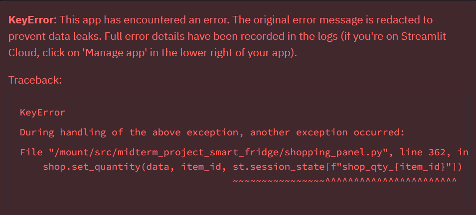

# 스마트 냉장고 & 장보기 리스트

## 1. 목적과 사용자

자취를 하면서 재료를 필요 이상으로 많이 사거나, 사 놓고 잊어버려 유통기한이 지나는 일이 많았습니다. 이 앱은 자취하는 대학생이 냉장고에 무엇이 어디 있는지, 언제까지 먹어야 하는지 알려주고 볼 수 있는 웹앱입니다.

핵심기능으로 유통기한이 임박하거나 지난 재료를 색으로 알려 주고, 냉장고 모양 화면을 통해 재료가 어디에 있는지 확인할 수 있는 기능이 있습니다. 그 외에도 부족한 재료를 장바구니에 담아주거나 

## 2. 실행 방법

**배포 사이트**: https://smart-fridge.streamlit.app/

'회원가입' 탭에서 닉네임과 비밀번호로 계정을 만들고, 사이드바의 테스트 데이터 넣기를 누르면 임상 재료로 기능을 확인해 볼 수 있습니다. 처음 열때는 서버가 잠들어 있어 한번 깨워줄 필요가 있습니다.

## 3. 작업 과정

1. `CLAUDE.md`에 만들 기능과 작업 규칙을 단계별로 정리
2. 냉장고 목록, 유통기한 알림, 재료 분류
3. 장보기 리스트, 냉장고 칸별 저장 위치, 요리 추천
4. 화면 디자인: 냉장고 모양 화면, 다크 모드, 휴대폰 화면
5. 영수증 읽기, 구매 적정량 추천
6. 인터넷 최저가 기능 추가 중 한계로 제외
7. 개인 로그인 기능을 추가하여 사용자별로 냉장고를 분리
8. 배포 사이트 오류 수정, 영수증 읽기를 전용 API로 변경


## 4. Claude Code 증거와 확인 결과

**대표 사례 확인**: 기능을 고칠 때마다 시험용 계정으로 브라우저에서 직접 눌러 확인했습니다. (재료 넣기 → 유통기한 색 표시, 장바구니 → 구매 → 냉장고 넣기, 영수증 → 냉장고 넣기)

**작업 계획 파일**: 할 일과 상태를 파일에 적어 두게 해서, 대화가 길어져도 무엇을 하던 중인지 놓치지 않았습니다.

```
| 3 | 로그아웃·테스트 데이터 오류 (배포) | 고침, 푸시 8a83d8f |
| 8 | 영수증: Upstage API로 읽기 + 카메라 대신 올리기 | 푸시 95a5ce6, 배포 확인 완료 |
```

**실패 사례: 배포 사이트 오류**: 로그인 기능을 만든 후 테스트 데이터를 넣거나 로그아웃 시에 에러가 발생.



오류 화면을 보내자 Claude Code가 내 컴퓨터에서 같은 오류를 재현해 원인을 찾았습니다.

> 테스트 데이터를 넣으면 화면 기억을 한꺼번에 지워요. 그 직후에 장바구니의 수량 칸·체크박스가 저장을 시도하는데, 지워진 칸 값을 찾다가 멈췄어요.

지워진 값이면 저장을 건너뛰게 고친 뒤, 같은 순서로 다시 눌러 오류 없이 테스트 데이터가 들어가는 것을 확인했습니다.

**③ 실패 사례: 영수증 금액 줄**: AI로 영수증을 읽으면 '주문금액', '총 결제금액'까지 재료로 들어갔습니다. 영수증 인식 API(Upstage)로 바꾸고, 금액 줄과 봉투 줄을 일부러 섞은 시험용 영수증으로 다시 읽었습니다.

| 영수증 줄 | 읽은 결과 |
|---|---|
| 서울우유 1L | 우유 1L, 2,980원 |
| 국산콩 두부 300g | 두부 1개, 2,480원 |
| 대파 1단 | 대파 1단, 1,990원 |
| 비닐봉투, 주문금액, 할인, 총 결제금액, 카드 승인 | 모두 빠짐 |

## 5. 효과적이었던 방법 3가지

1. **디자인 스킬 쓰기**: discussions에 올라온 frontend-design 스킬로 색·글꼴 같은 디자인 방향을 정했습니다. 무엇보다 샘플 디자인을 먼저 볼 수 있어서 편했습니다.
2. **사본으로 먼저 확인하기**: 프로젝트 사본을 따로 만들어, 큰 변경은 사본 사이트에서 먼저 변경해 보고 수정한 후에 원본에 옮겨 푸시했습니다.
3. **전체 점검 따로 시키기**: 기능을 하나씩 붙이다 보니 비슷한 버튼이 여러 개 생기고, 같은 것을 다른 말로 부르는 곳도 생겼습니다. 기능 작업과 따로 전체 점검을 시켜 단어를 통일했고 작동하지 않는 버튼이나 중복 버튼을 쉽게 제거할 수 있었습니다.

## 6. 어려웠던 점 3가지

1. **인터넷 최저가**: 쿠팡은 외부 링크를 막고 네이버 쇼핑 API는 종료되어 최저가 기능 구현에 애를 먹었습니다. 결국 인터넷 전용 장바구니를 따로 만들고 최저가를 보는 기능은 계획에서 제외하였습니다.
2. **기본 요리 검색**: 식품안전나라 레시피는 건강식 또는 변형 요리가 주로 있어서, 기본 요리를 찾기 어려웠습니다. 기본 집밥이 있는 농식품정보원 레시피를 더하고, 이름이 짧은 요리부터 보여 주도록 바꿨습니다.
3. **영수증 금액 줄**: 처음엔 AI가 영수증을 읽게 하였더니 '주문금액', '총 결제금액'까지 재료로 인식하였습니다. 영수증 인식 API(Upstage)로 바꿨습니다.

## 7. 알려진 한계

- 영수증 기능에 대한 테스트가 부족하여 구겨지거나 테스트해보지 못한 형식의 영수증에서는 잘 작동하지 않을 수 있습니다.
- 인터넷 최저가 구현에 실패했습니다. 직접 가격을 비교한 후에, 인터넷으로 살 재료를 선택해야 합니다.
- PC로 작업하다보니 휴대폰에서의 작동방식을 충분히 고려하지 못하였고, 휴대폰에서의 작동에 많은 불편함이 존재합니다. 사실상 PC에서만 사용 가능합니다.

## 8. 핵심 파일


| `fridge_store.py` | 재료 저장, 유통기한 계산(지남·임박), 냉장고 칸 추천과 위치 저장 |
| `fridge_board.py` | 냉장고 모양 화면, 재료를 칸에 끌어 놓기 |
| `views/fridge.py` | 냉장고 화면과 재료 추가·사용 팝업 |
| `shopping_panel.py` | 장보기: 다시 사기, 장바구니, 냉장고 넣기 |

## 사용한 API·데이터

[OpenRouter](https://openrouter.ai/), [Upstage](https://console.upstage.ai/docs/capabilities/extract/universal-extraction), [식품안전나라 레시피](https://www.foodsafetykorea.go.kr/), [농식품정보원 레시피](https://data.mafra.go.kr/), [농촌진흥청 메뉴젠](https://www.data.go.kr/data/15143471/openapi.do)(공공누리 제4유형), [Supabase](https://supabase.com/)
